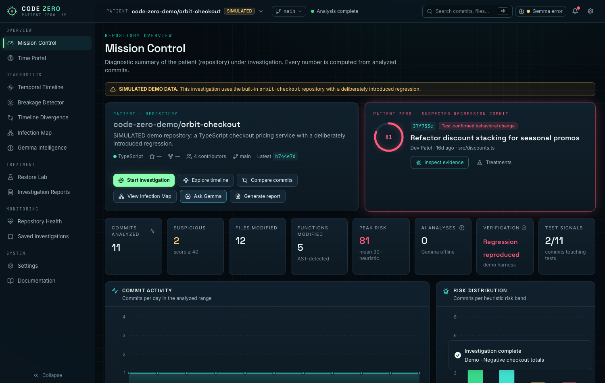
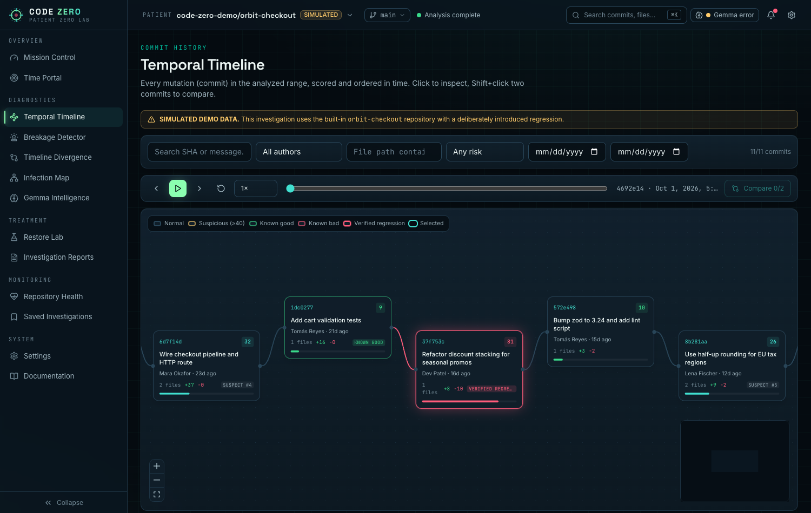
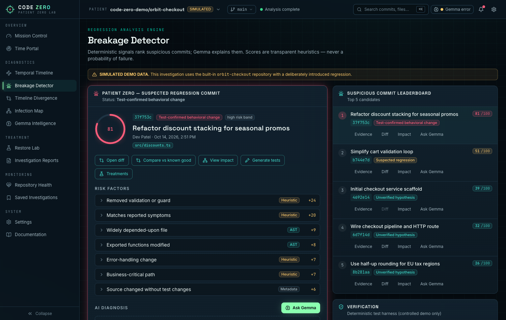
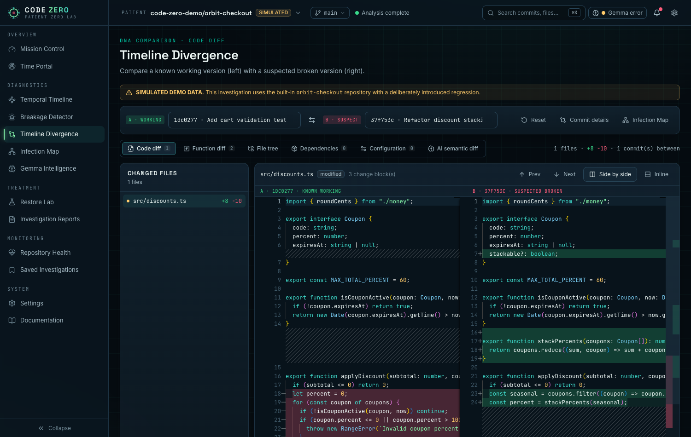
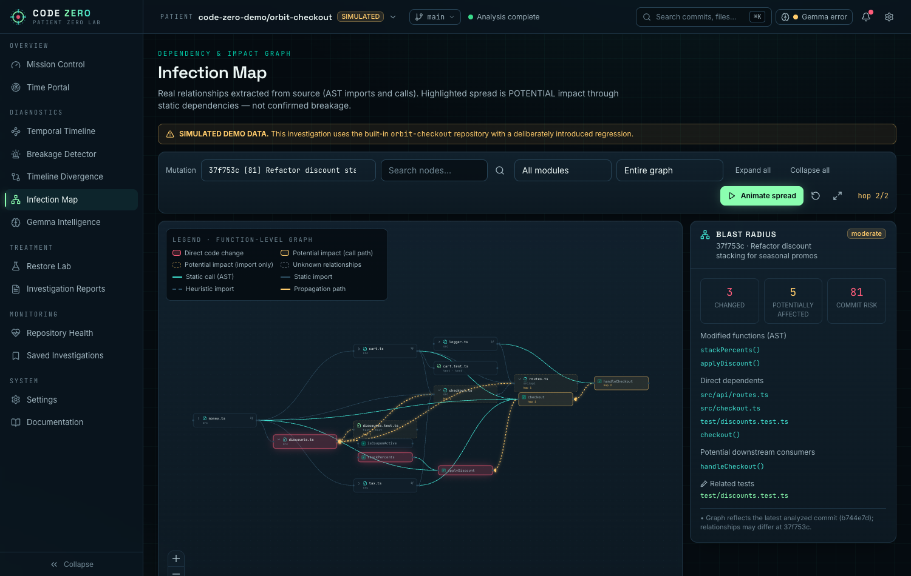
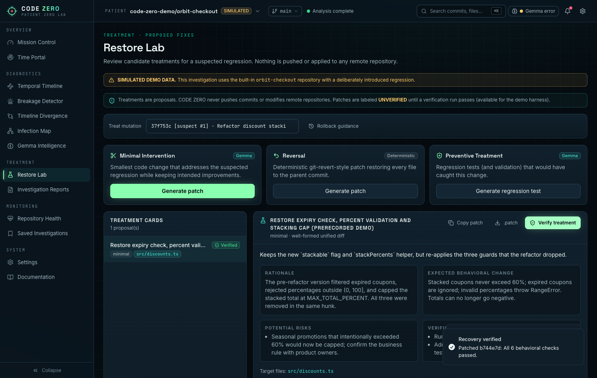
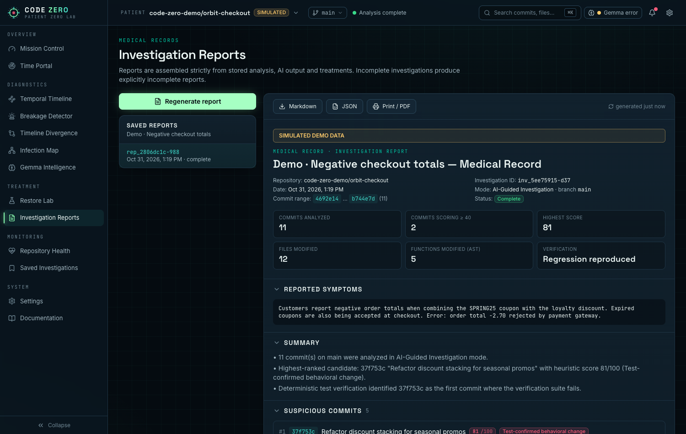

# CODE ZERO — Find Patient Zero in Your Codebase

**CODE ZERO** is an open-source, AI-powered regression investigation platform. It treats software regressions like infections:

| Themed | Technical meaning |
|---|---|
| Patient | GitHub repository |
| Mutation | Commit or code change |
| **Patient Zero** | Suspected regression-introducing commit |
| Infection Map | Dependency and impact graph |
| Diagnosis | AI-generated root-cause hypothesis (Gemma 4) |
| Treatment / Recovery | Proposed fix / validated fix or rollback |
| Medical Record | Investigation report |

You import a GitHub repository, and CODE ZERO does the rest:

- ranks suspicious commits using **transparent, evidence-linked risk signals**;
- traces potential spread through a **dependency graph built from the TypeScript compiler AST**;
- lets **Gemma 4** explain the evidence with Zod-validated, citation-checked output;
- previews treatments, verifies them on the controlled demo, and exports a full investigation report.



---

## Features

| Module | What it does |
|---|---|
| **Mission Control** | Repository identity, 8 metric cards computed from real data, commit activity & risk distribution charts, top suspects, hotspots, pipeline status (IMPORT → PARSE → COMPARE → DETECT → DIAGNOSE → REPORT), quick actions, recent investigations. |
| **Time Portal** | Import by URL or `owner/repo`; branch, date range, commit limit; five modes: **Quick Scan**, **Regression Hunt** (good/bad SHAs), **Single Commit**, **Repository Exploration**, **AI-Guided** (symptoms steer ranking). Live SSE progress across 8 stages. |
| **Temporal Timeline** | React Flow commit chain with zoom/pan, hover, click-to-inspect drawer, search & filters (author, date, file, risk), Shift+click to compare, bookmarks, playback (play/pause/step/speed/scrubber/reset), and a per-file **Code Change Trail**. |
| **Breakage Detector** | Deterministic analysis + ranking. Patient Zero panel, top-5 leaderboard, risk factors labeled **AST / Heuristic / Metadata**, evidence, AI diagnosis, verification steps, transparent weight table. Distinguishes *suspected*, *test-confirmed*, *unverified hypothesis* and *insufficient evidence*. |
| **Timeline Divergence** | Monaco side-by-side/inline diff with prev/next change navigation and tabs for Code, Function (AST), File Tree, Dependency (`package.json`), Configuration and **AI Semantic Diff**. |
| **Infection Map** | Function-level graph from real imports and calls (dagre layout). Node states: healthy, directly modified, high-risk, potentially affected (call path vs. import only), unknown. Animated hop-by-hop propagation, blast radius panel, search, module filter, expand/collapse, dependency/dependent highlighting, related commits, source viewer. |
| **Gemma Intelligence** | Seven structured tasks (root cause, why flagged, semantic diff, impact, tests, fixes, alternative hypotheses) at Beginner/Developer/Expert level, plus a streaming chat with stop/retry/copy, suggested prompts and a context indicator. |
| **Restore Lab** | Minimal (Gemma), Reversal (deterministic revert) and Preventive (regression tests) treatments; Monaco patch preview; copy / download `.patch`; rollback guidance; patch validation; **demo-only verification** that re-runs the behavioral suite on the patched code. |
| **Investigation Reports** | Persisted reports with collapsible sections and evidence; export as Markdown, JSON or print/PDF. Incomplete investigations produce explicitly incomplete reports. |
| **Repository Health** | Activity, contributors, churn heatmap, risk trend, hotspots, language distribution, and test/manifest/config change indicators. Does not claim test coverage. |
| **Saved Investigations** | Search, sort, filter, rename, reopen, duplicate, delete, resume, notes and bookmarks (SQLite). |
| **Global UX** | ⌘K command palette with global search (commits, files, functions, findings, investigations), notification center, URL-synced state and deep links, `g`+digit shortcuts, resizable panels, reduced-motion support, responsive layout. |

### Honesty rules built into the product

- Risk scores are heuristics (0–100). They are never shown as probabilities.
- Every finding carries evidence references: commit SHA, file, line and snippet.
- Gemma output is validated with Zod. Evidence IDs the model invents are stripped and flagged.
- When Gemma is unavailable, demo analysis is labeled **PRERECORDED**. It is never passed off as live inference.
- Imported repository code is **never executed**. Verification runs only on the controlled demo, inside an isolated `vm` context.
- Patches are labeled **UNVERIFIED** until a verification run passes. Nothing is ever pushed to a remote.

---

## Screenshots

| | |
|---|---|
|  |  |
|  |  |
|  |  |

---

## Quick start

**Requirements:** Node.js ≥ 20, npm ≥ 10. Ollama (optional) for live Gemma.

```bash
git clone <your-fork-url> code-zero && cd code-zero
npm install
cp .env.example .env          # optional: add GITHUB_TOKEN, choose your Gemma model
npm run dev                   # API on :8787, web on :5173
```

Open **http://localhost:5173** and click **Launch Demo Investigation**.

| Script | Purpose |
|---|---|
| `npm run dev` | API (tsx watch) + web (Vite) together |
| `npm run build` | Typecheck + production build of the web app |
| `npm start` | Run the API (serve `apps/web/dist` with any static server) |
| `npm test` | All unit, integration and frontend tests |
| `npm run typecheck` | TypeScript across every workspace |
| `npm run lint` | ESLint |

### Environment variables

See [`.env.example`](.env.example). All secrets stay on the backend.

| Variable | Default | Purpose |
|---|---|---|
| `PORT` / `HOST` | `8787` / `127.0.0.1` | API server |
| `DATABASE_PATH` | `./code-zero.db` | SQLite file (relative to repo root) |
| `GITHUB_TOKEN` | — | Raises GitHub limit from 60 to 5,000 req/h |
| `AI_PROVIDER` | `ollama` | `ollama` or `gemini` |
| `OLLAMA_BASE_URL` | `http://localhost:11434` | Ollama endpoint |
| `OLLAMA_MODEL` | `gemma4` | Any installed Gemma 4 tag |
| `GEMINI_API_KEY` / `GEMINI_MODEL` | — / `gemma-4-26b-a4b-it` | Gemma via the Gemini API |
| `MAX_GRAPH_FILES`, `MAX_PARSE_FILES_PER_COMMIT`, `MAX_FILE_BYTES`, `AI_TIMEOUT_MS` | see file | Analysis bounds |

### Connecting Gemma 4

**Option A — Ollama (local or Ollama cloud)**

```bash
ollama serve
ollama pull gemma4            # or a specific tag, e.g. gemma4:e4b
# set OLLAMA_MODEL to the exact tag shown by `ollama list`
```

**Option B — Gemini API**

```bash
AI_PROVIDER=gemini
GEMINI_API_KEY=...            # from Google AI Studio
GEMINI_MODEL=gemma-4-26b-a4b-it   # or gemma-4-31b-it; any Gemma model your key lists
```

Then open **Settings → Test connection**. The status check does more than list models: it runs a one-token generation. That catches failures a model listing misses, such as an exhausted cloud quota, and the UI shows the provider's exact error.

### Demo mode

The built-in demo is **`code-zero-demo/orbit-checkout`**, a simulated TypeScript checkout service with 11 commits. Commit 6, *"Refactor discount stacking for seasonal promos"*, quietly removes three things:

- the coupon-expiry filter;
- the percentage validation;
- the 60% stacking cap.

Stacked coupons can then push totals negative. Several realistic decoys are mixed in: a cart-validation refactor that the heuristics flag but tests clear, a dependency bump, and an EU tax rounding change.

The demo needs neither GitHub nor Gemma. Its diffs are generated from file snapshots, so every patch, line number and score stays internally consistent. A deterministic harness bisects the history and confirms the regression. See [`demo/README.md`](demo/README.md).

---

## Architecture

```text
code-zero/
├── apps/
│   ├── web/        React 19 · Vite · Tailwind v4 · React Flow · Monaco · Recharts · TanStack Query · Zustand
│   └── api/        Fastify · Octokit · better-sqlite3 · SSE · Ollama / Gemini providers · Zod
├── packages/
│   ├── shared/     Domain types, Zod schemas (requests + AI output), terminology
│   └── analysis/   Diff parser, TypeScript-AST parser, dependency graph, risk scoring,
│                   ranking, health, report builder, patch utils, demo fixture + harness
├── demo/           Demo repository documentation
└── docs/           Architecture, API reference, screenshots
```

Pipeline: **Import → Commit retrieval → Diff extraction → AST parsing → Change classification → Dependency analysis → Risk scoring → Suspect ranking → Gemma investigation (on demand) → Evidence aggregation → Report**.

Details: [docs/ARCHITECTURE.md](docs/ARCHITECTURE.md) · API: [docs/API.md](docs/API.md)

---

## Testing

```bash
npm test
```

- **`packages/analysis`, 34 tests:** URL parsing, commit-range validation, diff parsing, AST extraction, import resolution, risk scoring, ranking, dependency-graph construction, blast radius, evidence traceability, bisect verification, report generation, patch validation, manifest diffing.
- **`apps/api`, 11 integration tests:** import, investigation creation, end-to-end analysis, impact, commit comparison, prerecorded fallback, AI output validation with **mocked inference**, treatment generation and verification, report persistence and export, rename/duplicate/delete.
- **`apps/web`, 6 tests:** navigation, the repository import form, demo mode, URL state sync across modules, compare selection, and the commit drawer.

---

## Known limitations

- Function-level analysis covers **JS/TS** (TypeScript compiler AST). Python imports are regex-detected at file level. Other languages appear as graph nodes without edges.
- Only relative imports are resolved. Path aliases, dynamic dispatch, callbacks and instance-method calls are not.
- The dependency graph reflects the latest analyzed commit, not each historical state.
- GitHub may truncate very large diffs and trees. Affected files are reported as skipped.
- Unauthenticated GitHub access is limited to 60 requests/hour. Set `GITHUB_TOKEN` for real use.
- Automated verification works only on the controlled demo. Imported repositories are never executed.
- Heuristic signals produce false positives by design; the demo includes one on purpose.

## Roadmap

- Sandboxed test execution (rootless containers with resource limits and explicit consent) for imported repositories
- `git bisect` driven by a user-supplied test command, inside that sandbox
- Historical dependency graphs per commit; tsconfig path-alias resolution
- Tree-sitter parsers for Python, Go and Rust function-level analysis
- GitHub App mode: open a draft PR with a verified treatment (opt-in)
- Shared team investigations and comments

## Contributing

See [CONTRIBUTING.md](CONTRIBUTING.md).

## License

[Apache-2.0](LICENSE)
